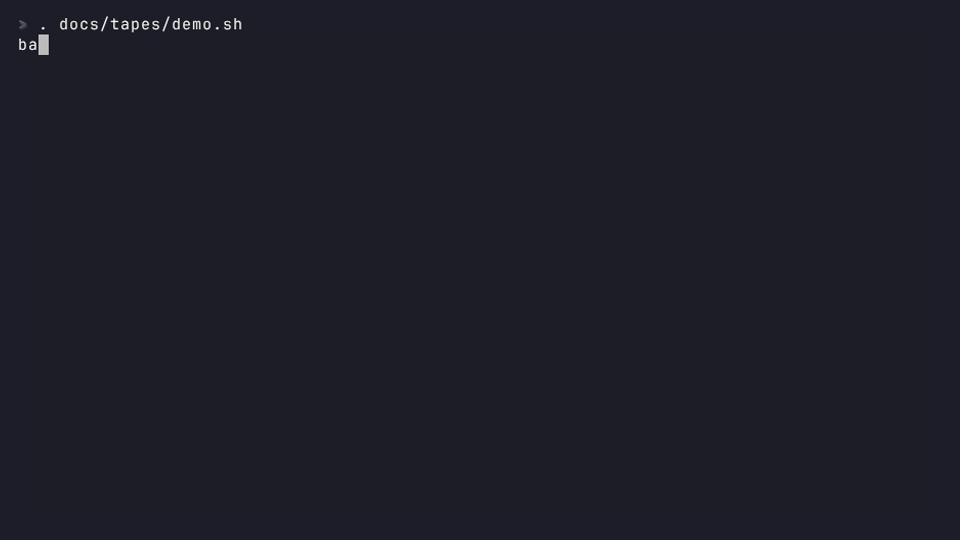

# balanda

[](https://github.com/Ar4ikov/balanda/actions/workflows/ci.yml)
[](https://github.com/Ar4ikov/balanda/releases/latest)
[](https://github.com/Ar4ikov/balanda/releases)
[](go.mod)
[](https://goreportcard.com/report/github.com/Ar4ikov/balanda)
[](LICENSE)
[](#установка)
[](https://www.conventionalcommits.org/ru/v1.0.0/)


Баланда — тюремная похлёбка «из чего было», а травить баланду — болтать и рассказывать байки. balanda — консольная тулза из четырёх частей, сваренных в один бинарник:

- **камера** запускает процесс с ограниченной «пайкой» CPU, памяти и времени;
- **объедки** находят и удаляют мусор сборок и кэшей;
- **вода** льёт канцелярский текст и меряет водность чужого;
- **байки** рассказывают айтишные истории в терминале.

Команды написаны транслитом, у большинства есть английские псевдонимы: `run`, `ps`, `audit`, `stop`, `clean`, `pour`, `check`, `tell`. Справка по-русски: `balanda --help`, `balanda <команда> --help`.

## Камера


```sh
balanda sadit --paika cpu=1,mem=256m,time=30s -- make test   # посадить с пайкой
balanda sadit --fon --imya sborka --set --paika mem=1g -- go build ./...
balanda pereklichka                                          # список камер
balanda shmon sborka                                         # аудит
balanda otboy                                                # погасить все камеры
```

`sadit` ждёт, пока команда выйдет, и возвращает её код выхода. Если вышло время, код 124, как у `timeout`. С `--fon` команда уходит в фон, её вывод пишется в журнал камеры. `pereklichka` проверяет каждую сидящую камеру: жив ли процесс и его надзиратель. `shmon` показывает CPU, память, процессы, открытые файлы и код выхода. `otboy` гасит всё дерево процессов: сначала SIGTERM, через 2 секунды SIGKILL.

Пайка задаётся строкой `cpu=<ядра>,mem=<размер>,time=<длительность>`: `cpu=0.5`, `mem=256m` или `mem=1g`, `time=30s` или `time=5m`. Записи о камерах лежат в `$XDG_STATE_HOME/balanda` (по умолчанию `~/.local/state/balanda`) на Linux и в `os.UserConfigDir()` на macOS и Windows; каталог меняется переменной `BALANDA_STATE_DIR`.

### Изоляция

По умолчанию камера — одиночка: сеть закрыта, вся система только на чтение, писать можно в рабочий каталог и во временный каталог камеры. Ключи и токены из домашнего каталога (`~/.ssh`, `~/.aws`, `~/.kube`, `~/.docker`, `~/.config/gh` и другие) и сокет Docker спрятаны, на Linux и macOS даже тогда, когда рабочий каталог — весь дом. На Windows рабочий каталог открыт целиком, вместе с тем, что в нём лежит. Флаги:

```sh
balanda sadit --set -- npm ci                       # оставить сеть
balanda sadit --zapis ~/.cache/go-build -- go test ./...   # ещё каталог на запись
balanda sadit --bez-doma -- ./script.sh              # спрятать домашний каталог целиком
balanda sadit --bez-izolyacii -- make install        # без изоляции, как обычный запуск
```

Работает ли изоляция на этой машине, пишет `balanda pereklichka`. Изоляция делит ядро с хостом, как любой контейнер, и от уязвимостей ядра не защищает: совсем чужой код лучше запускать в виртуальной машине.

### Что работает на какой платформе

| | Linux, cgroups v2 | Linux, rlimit | macOS | Windows |
|---|---|---|---|---|
| `cpu` | доля ядер, `cpu.max` | только вместе с `time`: RLIMIT_CPU на cpu × time секунд процессорного времени | только вместе с `time`: RLIMIT_CPU и сторож с тем же бюджетом | жёсткий потолок CPU rate у Job Object |
| `mem` | `memory.max`, своп выключен | RLIMIT_AS на каждый процесс | сторож суммирует RSS группы раз в 0,5 с | лимит памяти Job Object на всё задание |
| `time` | надзиратель: SIGTERM, через 2 с SIGKILL | так же | так же | TerminateJobObject |
| гасится всё дерево | `cgroup.kill` | группа процессов | группа процессов | Job Object |
| `shmon` | /proc и cgroup: CPU, память и её пик, процессы, открытые файлы | /proc: CPU, память, процессы, открытые файлы | ps и lsof: CPU, память, процессы, открытые файлы | Job Object: CPU, память и её пик, процессы; вместо списка файлов число дескрипторов |
| сеть | своё сетевое пространство имён, только `lo` | так же | sandbox-exec: закрыта, кроме localhost | AppContainer: закрыта |
| файлы | система только на чтение, свой `/tmp`, запись в рабочий каталог и `--zapis` | так же | sandbox-exec: запись в рабочий каталог, `--zapis` и свой `TMPDIR` | AppContainer: доступ только к рабочему каталогу, `--zapis` и каталогу программы |
| процессы | своё пространство PID: процессы хоста не видны | так же | видны, сигналы наружу запрещены | видны, Job Object |

На Linux изоляция строится на пространствах имён пользователя и root не требует. Ubuntu 23.10+ разрешает их только программам с профилем AppArmor: пакет .deb ставит такой профиль сам, при другой установке `balanda sadit` напишет готовую команду. На Windows программы, которым нужен профиль пользователя или реестр, в AppContainer могут не запуститься; тогда поможет `--bez-izolyacii`.

На Linux cgroups v2 работают без root, если у пользователя есть делегированная cgroup с контроллерами cpu и memory (обычно её создаёт systemd в `user@.service`) и balanda запущена внутри неё. Иначе включаются rlimit. Какой движок достанется новой камере, пишет первая строка `balanda pereklichka`; выбрать вручную можно переменной `BALANDA_ENGINE=rlimit` или `BALANDA_ENGINE=cgroup2`.

У rlimit есть ограничения. RLIMIT_AS считает виртуальную память, поэтому node, JVM и программы на Go с маленьким `mem` могут не запуститься. Сторож на macOS проверяет раз в полсекунды и короткий всплеск пропустит.

## Объедки



```sh
balanda scan ~/projects              # найти и показать размеры
balanda svarit ~/projects --dry-run  # показать, что будет удалено
balanda svarit ~/projects            # удалить после подтверждения
balanda svarit . --keshi --yes       # вместе с кэшами pip, npm, go и cargo
```

Что считается мусором:

- `node_modules`, `__pycache__`, `.pytest_cache`, `.mypy_cache`, `.ruff_cache`, `.tox`, `.hypothesis`;
- виртуальные окружения Python (любой каталог с `pyvenv.cfg`);
- `target` рядом с `Cargo.toml` или `pom.xml`, `build` и `.gradle` в проектах Gradle;
- `.next`, `.nuxt`, `.svelte-kit`, `.parcel-cache`, `.turbo`, `.angular` рядом с `package.json`, `.zig-cache` рядом с `build.zig`;
- локальные git-ветки, целиком влитые в `main` (или `master`, `trunk`), кроме текущей;
- с `--keshi`: кэши pip, npm (`_cacache`), go (сборки и модулей) и cargo;
- с `--docker`: висячие Docker-образы, если docker установлен.

`svarit` удаляет каталоги только внутри указанного пути. По символическим ссылкам обход не ходит. Кэши вне пути трогаются только с `--keshi` или `--docker`, и только из списка выше. Ветки удаляются после повторной проверки, что каждая целиком лежит в основной. Без терминала `svarit` не спрашивает и требует `--yes`.

## Вода


```sh
balanda nalit --abzacy 3 --stil gosuslugi   # стили: gosuslugi, korporat, nauka
balanda nalit -a 1 -s nauka --zerno 7       # одинаковое зерно — одинаковый текст
balanda proba README.md                     # водность от 0 до 100 с подсветкой
balanda nalit | balanda proba -             # текст можно подать на stdin
balanda proba --porog 40 docs/*.md          # код 1, если воды больше 40
```

`nalit` собирает текст из встроенных шаблонов и работает без сети. `proba` ищет штампы и пустые обороты, канцелярит, оценки без меры, офисный жаргон и цепочки отглагольных существительных, а ещё считает долю отглагольных существительных. Шкала: до 20 сухо, до 40 влажно, до 60 сыро, до 80 болото, дальше потоп. Это эвристика по словарю, а не детектор авторства.

Словари `proba` основаны на каталоге [avoid-ai-writing-russian](https://github.com/ormeilu/avoid-ai-writing-russian) (MIT, © 2026 Conor Bronsdon, Ilya Lubenets). Текст их лицензии лежит в [internal/voda/LICENSE-avoid-ai-writing-russian](internal/voda/LICENSE-avoid-ai-writing-russian).

## Байки


```sh
balanda travit                 # случайная байка
balanda travit --tema deploy   # 12 тем: deploy, git, prod, review, db, oncall, security, …
balanda travit --spisok        # список тем
```

Байка при открытии терминала: строка для `~/.bashrc` или `~/.zshrc`

```sh
command -v balanda >/dev/null && balanda travit
```

и для профиля PowerShell (`$PROFILE`):

```powershell
if (Get-Command balanda -ErrorAction SilentlyContinue) { balanda travit }
```

## Установка

### Linux и macOS

```sh
curl -fsSL https://raw.githubusercontent.com/Ar4ikov/balanda/main/install.sh | sh
```

Скрипт определяет ОС и архитектуру, качает последний релиз, сверяет sha256 по `checksums.txt` и кладёт бинарник в `~/.local/bin` (под root — в `/usr/local/bin`). Если каталога нет в `PATH`, скрипт подскажет, что добавить. Конкретная версия и свой каталог:

```sh
curl -fsSL https://raw.githubusercontent.com/Ar4ikov/balanda/main/install.sh | BALANDA_VERSION=v0.1.0 BALANDA_INSTALL_DIR=/opt/bin sh
```

### Windows

В PowerShell:

```powershell
irm https://raw.githubusercontent.com/Ar4ikov/balanda/main/install.ps1 | iex
```

Скрипт ставит `balanda.exe` в `%LOCALAPPDATA%\Programs\balanda` и добавляет этот каталог в пользовательский `PATH`. Версию задаёт `$env:BALANDA_VERSION = 'v0.1.0'` перед запуском.

### Пакеты .deb, .rpm, .apk

Пакеты лежат в [релизах](https://github.com/Ar4ikov/balanda/releases); в именах ниже подставьте номер последней версии и архитектуру (`amd64`/`x86_64` или `arm64`/`aarch64`).

```sh
# Debian, Ubuntu
curl -fsSLO https://github.com/Ar4ikov/balanda/releases/download/v0.1.0/balanda_0.1.0_amd64.deb
sudo dpkg -i balanda_0.1.0_amd64.deb

# Fedora, RHEL, openSUSE
sudo rpm -i https://github.com/Ar4ikov/balanda/releases/download/v0.1.0/balanda-0.1.0-1.x86_64.rpm

# Alpine (пакет не подписан)
apk add --allow-untrusted balanda_0.1.0_x86_64.apk
```

Пакеты ставят ещё и автодополнение для bash, zsh и fish.

### go install

```sh
go install github.com/Ar4ikov/balanda@latest
```

Нужен Go 1.27 или новее.

### Автодополнение

В архивах релиза есть каталог `completions/` с файлами для bash, zsh, fish и PowerShell. Их же печатает `balanda completion bash|zsh|fish|powershell`.

## Версии и релизы

Версии идут по SemVer, релиз выходит сам. После каждого зелёного CI на `main` workflow Release смотрит коммиты с последнего тега в формате Conventional Commits: `fix` и `perf` поднимают патч, `feat` — минорную версию, `!` или `BREAKING CHANGE` — мажорную (до 1.0 — тоже минорную). Если были только `docs`, `ci`, `chore` и подобные, релиз не выходит. Дальше workflow ставит тег, GoReleaser собирает архивы для linux, darwin и windows на amd64 и arm64, `checksums.txt`, пакеты .deb, .rpm и .apk, а заметки к релизу собираются из сообщений коммитов по разделам: новое, исправления, документация, сборка. Какой релиз выйдет после слияния PR, видно в сводке CI этого PR. Установленную версию, коммит и дату сборки показывает `balanda version`.

## Лицензия

[MIT](LICENSE).
